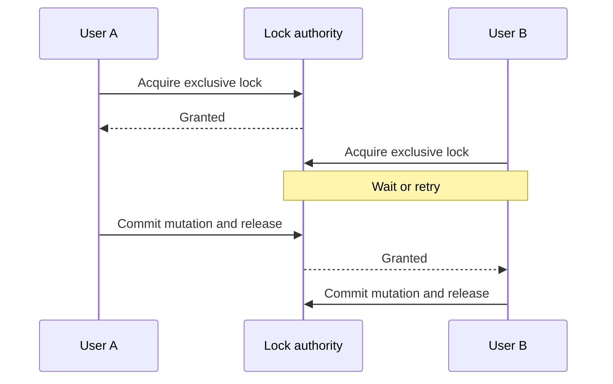
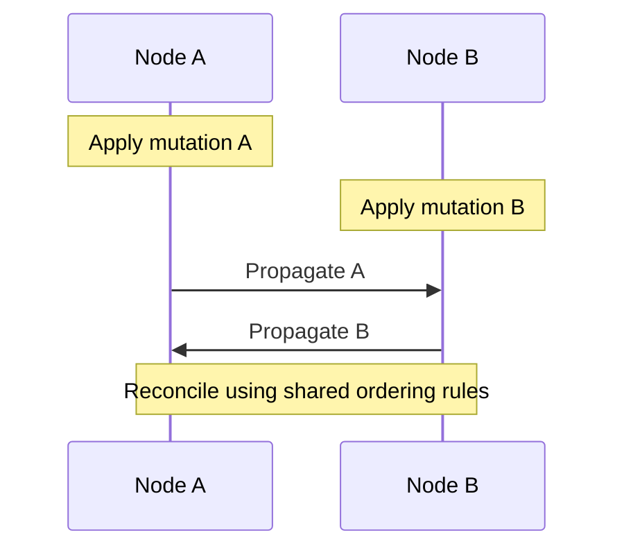
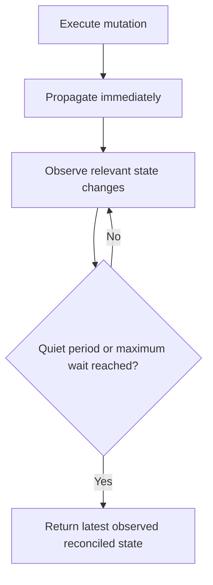
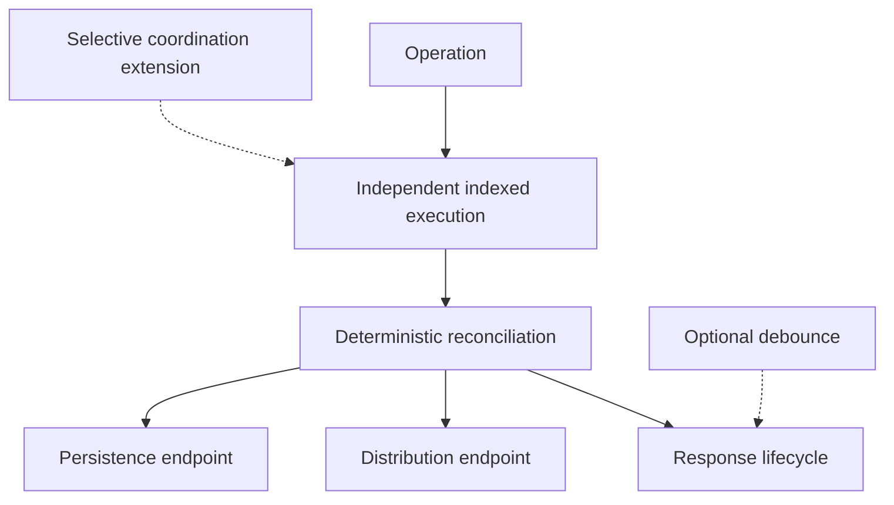
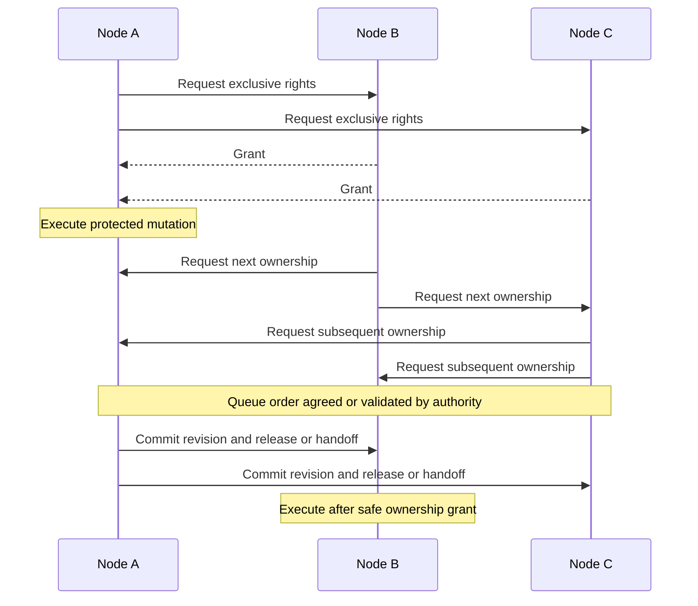

# Transactions vs. Synchronization

> Synchronization is foundational. Transactions are selective.

**Version 0.3 — Architectural comparison and proposed coordination roadmap**

## An architectural perspective from CoCreateDB

A distributed database must accommodate change. Objects are created, keys are updated, mutations travel across networks, and applications continuously consume changing state.

The architectural question is not whether transactions are useful. It is whether transactional coordination must be a prerequisite for ordinary database execution.

CoCreateDB proposes a synchronization-first foundation: execute independently, propagate immediately, reconcile deterministically, and introduce stronger guarantees where the operation requires them.

**Transaction-capable, not transaction-dependent.**

This document compares execution models, not measured implementations. The mechanisms described as extensions are design proposals, not claims of currently implemented CoCreateDB APIs.

## Table of contents

1. [Execution models](#1-execution-models)
2. [The cost of anticipated contention](#2-the-cost-of-anticipated-contention)
3. [Ordering without locking](#3-ordering-without-locking)
4. [The temporal boundary](#4-the-temporal-boundary)
5. [Response stabilization](#5-response-stabilization)
6. [Document-level coordination](#6-document-level-coordination)
7. [Ticket allocation](#7-ticket-allocation)
8. [Transactions as data](#8-transactions-as-data)
9. [Guarantees as operators](#9-guarantees-as-operators)
10. [Composable infrastructure](#10-composable-infrastructure)
11. [Comparative assessment](#11-comparative-assessment)
12. [Architectural principles](#12-architectural-principles)
13. [Native transactional coordination roadmap](#13-native-transactional-coordination-roadmap)

## 1. Execution models

A transaction groups operations under defined guarantees, potentially including atomicity, isolation and durability. Pessimistic locking is one technique for providing isolation; optimistic validation, multiversion concurrency control (MVCC), consensus and other techniques also exist.

Synchronization propagates changes between copies of data. Deterministic reconciliation resolves incompatible changes according to an explicit policy. Neither requires that every mutation acquire exclusive ownership before execution.

These concepts are complementary, not mutually exclusive. Transactional systems also synchronize replicated state, and synchronization-first systems can support coordinated operations.

The comparison here specifically targets engines where transactional coordination is an unavoidable execution dependency versus engines that can compose it selectively.

### Pessimistic execution



### Synchronization-first execution



For two unconditional assignments with equivalent winning order, both models can produce the same final value. The synchronization-first model does not require a distributed exclusive lock for this operation.

## 2. The cost of anticipated contention

Pessimistic locking protects against potential contention even when no competing writer exists. An uncontended lock may be inexpensive and local; it need not involve a network round trip. A distributed lock may require communication with an authority or quorum, not every server.

Consider 1,000 independent assignments performed using a lock per assignment:

| Responsibility | Pessimistic model | Synchronization-first model |
|---|---:|---:|
| Logical lock acquisitions | 1,000 | 0 |
| Logical lock releases | 1,000 | 0 |
| Mutations | 1,000 | 1,000 |
| Ordering metadata or equivalent | Required | Required |
| Replication, when requested | Required | Required |
| Waiting for competing lock holders | Possible | Not required |

These are illustrative logical operation counts, not measured network messages or performance benchmarks. Real systems may batch operations, use optimized latches, or avoid pessimistic locks entirely.

The opportunity is to remove coordination from the critical path when the operation does not need it, rather than claim concurrency management is free.

**Pay for coordination where coordination contributes to correctness.**

### 2.1 Computational and economic cost of mandatory coordination

The absence of contention does not necessarily eliminate the cost of preparing for contention. When a protocol requires acquisition, validation and release on every mutation, those steps remain part of the execution path even when every writer targets an independent resource.

| Resource | Potential overhead avoided on independent operations |
|---|---|
| CPU | Transaction contexts, lock bookkeeping, validation and scheduling |
| Memory | Ownership records, wait queues, transaction metadata and retained versions where applicable |
| Network | Coordination requests, grants, acknowledgments and releases |
| Latency | Critical-path coordination round trips and waiting for participants |
| Throughput | Unnecessary serialization and coordination bottlenecks |
| Storage I/O | Transaction-specific logging and commit records where required by the protocol |
| Availability | Dependencies on reachable coordination authorities or participants |
| Engineering | Deadlock handling, recovery, retry and ownership management in ordinary execution paths |

These are potential savings relative to a protocol that actually incurs these costs. Synchronization, durable logging, index maintenance, reconciliation and local concurrency protection still consume resources. Native optional coordination adds implementation and maintenance costs even when it is not invoked.

### 2.2 Illustrative workload economics

Assume 10,000 mutations per second, one logical acquisition and release per protected mutation, and identical per-lock costs. Compare mandatory locking with a workload in which 5% of mutations require protection.

| Metric | Mandatory | Selective (5%) |
|---|---:|---:|
| Mutations/s | 10,000 | 10,000 |
| Protected mutations/s | 10,000 | 500 |
| Logical lock operations/s | 20,000 | 1,000 |
| Logical lock operations/hour | 72,000,000 | 3,600,000 |
| Logical lock operations/day | 1,728,000,000 | 86,400,000 |

The selective model avoids 95% of the modeled lock operations, or 1.6416 billion per day. This is not a 95% reduction in total CPU, latency or infrastructure spending.

For an illustrative all-participant handshake with `p` remote participants, each protected operation sends `p` requests, receives `p` grants and sends `p` release notifications: `3p` coordination messages, excluding release acknowledgments, retries, membership and commit propagation. With four remote participants and 10,000 mutations/s, that is 120,000 messages/s under mandatory coordination versus 6,000 at 5%. Actual protocols may batch, combine release with replication, use local authorities or quorums, or avoid these exchanges altogether.

The acquisition phase adds at least one request/grant round trip in this example, bounded by the slowest required participant when requests run in parallel, not the sum of all participant latencies. Handoffs can amortize acquisition costs when contention is sustained. Ordinary propagation may still occur in both models.

The economic opportunity is to scale coordination work with the protected fraction of the workload rather than total writes. Translate this into actual compute, memory, bandwidth and infrastructure savings only after measuring equivalent workloads and guarantees. Measure CPU time per operation, peak memory, bytes and messages per mutation, p50/p95/p99 latency, throughput, recovery cost and monthly provisioned capacity.


## 3. Ordering without locking

Suppose two users update the same key:

```js
// Mutation A
{ name: "James" }

// Mutation B
{ name: "John" }
```

A deterministic last-writer-wins policy can select the winning assignment using stable mutation metadata, for example a hybrid logical timestamp, node identifier and unique mutation identifier.

| Mutation | Logical ordering | Value |
|---|---|---|
| A | (1000, 0, node-a) | James |
| B | (1001, 0, node-b) | John |
| C | (1001, 0, node-c) | Michael |

With the illustrated ascending ordering policy, C wins. Nodes receiving all three mutations can independently calculate the same result regardless of delivery order.

Physical timestamps and clock offsets alone do not guarantee real-world chronological order. Hybrid logical clocks preserve known causal relationships and supply a deterministic ordering when combined with stable tie-breakers. Concurrent events need not have a uniquely observable real-world first event.

Lock acquisition, similarly, may reflect network arrival and scheduling rather than creation time. A deterministic tie-breaker does not need to be negotiated for each unconditional competing assignment.

### Disjoint keys and increments

```js
// Mutation A
{ name: "James" }

// Mutation B
{ email: "james@example.com" }
```

Key-level reconciliation can preserve both updates rather than overwrite an entire object. Independent increments can also commute when applied with appropriate deduplication and counter semantics.

Delete/update conflicts, nested parent-child changes, duplicate delivery and index maintenance require explicit resolution rules. Conditional operations depending on intermediate state are not automatically equivalent to ordered assignments.

**Persist by object. Index by key. Reconcile by mutation. Coordinate by necessity.**

## 4. The temporal boundary

A successful transaction has a defined consistency boundary. It does not make the resulting state permanently current.

| Time | Event | State |
|---:|---|---|
| 0 ms | Transaction A begins | Original |
| 20 ms | Transaction A commits | A |
| 21 ms | Response delivered | A |
| 30 ms | Transaction B commits | B |
| 40 ms | Transaction C commits | C |

The response was valid at its defined consistency point and became outdated shortly afterward. A reactive application still needs a mechanism to observe subsequent changes.

This is not a failure of transactional isolation: isolation never promised perpetual freshness. It demonstrates why isolation cannot replace synchronization.

A request in transit may become a later transaction. A request in transit may also become a later synchronization event. Neither model can predict future changes.

**A consistent snapshot is not necessarily a current view.**

Transactions establish correctness within an execution boundary. Synchronization maintains convergence beyond it.

## 5. Response stabilization

A fixed delay allows time for additional mutations to arrive. A mutation-aware debounce goes further: it resets a quiet-period timer whenever a relevant state change is observed, subject to a maximum wait.

| Time | Event | State |
|---:|---|---|
| 0 ms | Apply and propagate A | A |
| 10 ms | Observe B; restart timer | B |
| 20 ms | Observe C; restart timer | C |
| 70 ms | 50 ms quiet period ends; return | C |

This example returns a more consolidated observed state than an immediate response after A. It also deliberately adds response latency.



Conceptual lifecycle pseudocode:

```js
// Illustrative policy, not a CoCreateDB API.
observeRelevantChanges();
applyMutation();
propagateMutation();
await quietPeriodOrDeadline();
return latestObservedState();
```

A real implementation must subscribe without missing the initial change, track a monotonic deadline, capture the returned revision consistently, and clean up subscriptions. Only relevant changes should reset the timer. A maximum wait prevents indefinite postponement under sustained activity.

A quiet period is evidence of observed stability, not proof that all peers have converged. An unseen mutation may arrive later. A debounce cannot substitute for isolation or safe irreversible confirmation. The same response policy can also be layered on a transactional engine.

**Stabilize the response, not the execution.**

## 6. Document-level coordination

When a document genuinely requires exclusive access or stronger operational guarantees, several mechanisms can be composed around the same core.

| Mechanism | Suitable objective | Limitation |
|---|---|---|
| Deterministic reconciliation | Unconditional competing assignments | Does not grant exclusive rights |
| Key-level merge | Independent property updates | Requires defined overlap rules |
| Debounced response | Observed state stabilization | Not a global consistency barrier |
| Atomic conditional update | Validate a revision or condition before committing | Requires an authoritative atomic decision |
| Document-scoped lock | Exclusive mutation access | Requires enforcement by all protected writers |
| Designated authority | Order operations on a particular resource | Authority availability and failover matter |
| Escrow or preallocated rights | Enforce bounded allocation locally | Rights redistribution requires coordination |

### Selective document lock

An application may request an exclusive right for a specific object, perform a protected operation, and release the right. Acquisition must be authoritative, not merely a broadcast of intent. Leases, fencing tokens and recovery rules may be needed to prevent an expired owner from writing.

All writers of the protected state must participate in the protocol; an ordinary mutation cannot be allowed to bypass an active constraint. Unrelated objects and keys need not inherit it.

A lock alone is not a general ACID transaction. Atomic publication, rollback or recovery and appropriate read visibility must be implemented if those guarantees are required.

**Coordinate the resource that requires coordination, not the entire infrastructure.**

## 7. Ticket allocation

Consider an event with 10,000 available tickets. A common implementation maintains an authoritative shared counter. Every purchase competes to increment that counter without exceeding capacity.

An alternative models the allocation records that the application already needs:

```js
// Event
{ capacity: 10000 }

// Independent purchase attempt
{
    event_id: "event-reference",
    user_id: "user-reference",
    status: "pending"
}
```

Each attempt has its own immutable address and ordering metadata. An index over the event's attempts supports counting and ordered allocation. A derived tickets-sold count need not be the authoritative concurrency point.

| Allocation rank | Provisional result |
|---:|---|
| 9999 | Accepted |
| 10000 | Accepted |
| 10001 | Rejected |
| 10002 | Rejected |

With the same complete set of attempts and the same rules, replicas independently compute the same provisional allocation. The model also preserves individual purchaser records and an audit history.

### Confirmation versus provisional allocation

A late-arriving earlier-ranked attempt could displace an already accepted attempt. A debounce reduces the chance of premature confirmation but does not eliminate it.

If no purchaser may ever be displaced after confirmation, an application can use:

- An authoritative allocator for the final ticket positions.
- Preallocated, non-overlapping ticket rights distributed across nodes.
- Selective consensus or an atomic capacity-checked reservation.
- A finalized allocation batch with an enforceable cutoff, after which new arrivals cannot modify that batch.

The finalization rule must actually exclude conflicting confirmations. Counting local documents, assigning UUIDs or observing a quiet period alone cannot enforce a global capacity limit under network partitions.

Payment capture, retries, cancellation and refunds also require idempotency and explicit lifecycle rules.

This does not make general-purpose transactional coordination mandatory. It isolates the constraint to the allocation lifecycle and removes the shared counter from ordinary independent object creation.

**Accept independently. Allocate deterministically. Confirm safely.**

## 8. Transactions as data

An application can represent a proposed transaction as an object containing a sequence of operations:

```js
// Illustrative data model, not a public API.
{
    status: "pending",
    operations: [
        { resource: "account-a", delta: -100 },
        { resource: "account-b", delta: 100 }
    ]
}
```

The object can be stored, indexed, propagated, validated and retained as an audit record. Temporary arrays or objects can stage related mutations before finalization.

A single atomic publication of a transaction record can represent a logical commit if all readers interpret committed records consistently. Materialized projections may then be derived asynchronously. This is distinct from promising atomic visibility of arbitrary separately updated documents.

For a transfer, a correct implementation must also prevent double spending, validate constraints against an authoritative state or allocated rights, handle duplicate execution, and recover safely after failures. If multiple artifacts must become visible atomically, a commit protocol or equivalent publication mechanism is needed.

Event sourcing, optimistic concurrency control, sagas and escrow allocation provide related patterns. Sagas offer compensation rather than full ACID isolation; not every external action is reversible.

**Data can represent transactions without requiring every data mutation to be transactional.**

## 9. Guarantees as operators

CoCreateDB's operation-oriented architecture provides a natural place to express additional execution semantics. In the same spirit that an increment operator expresses a specific mutation, a coordination operator could express a specific transactional requirement.

| Concept | Purpose |
|---|---|
| Assignment | Set a key |
| Increment | Apply a numeric delta |
| Conditional mutation | Apply only if a defined predicate holds |
| Coordination extension | Establish an enforceable execution boundary |
| Response debounce | Observe relevant state changes before returning |

All CoCreateDB operators use the `$` prefix. Proposed operators such as `$transactional`, `$unique` and `$debounce` follow this convention; their semantics and payload contracts are not finalized. The unified operation entry point remains `DB.send(operation)`; exact payload contracts are outside this document.

The scope might be a key, object, index constraint, array or workflow. Persistent configuration can also require protection automatically for every applicable operation; see the native coordination roadmap in Section 13. The required guarantee should determine the enforcement mechanism. This is additive composition rather than a requirement for a global engine mode switch.

## 10. Composable infrastructure

CoCreateDB separates core execution from connected infrastructure:



- Distribution awareness identifies where relevant artifacts are held or needed.
- Persistence destinations determine where artifacts are stored or replicated.
- Response policies determine when results are returned.
- Coordination extensions enforce specific constraints where required.

Required durability or acknowledgment policies may affect response timing. Missing data may require acquisition. Independent execution does not imply that these costs disappear.

**One core. Composable infrastructure.**

## 11. Comparative assessment

The central theoretical comparison is between two deliberately defined architectures, not between every database marketed as transactional or non-transactional.

| Capability | Inherently transaction-dependent engine | Synchronization-first engine with equivalent extensions |
|---|---|---|
| Coordinated execution | Yes | Yes, where implemented |
| Independent uncoordinated mutations | Not if forbidden by core design | Yes |
| Deterministic reconciliation | Can be added | Foundational |
| Continuous synchronization | Can be added or native | Foundational in connected topology |
| Response debounce | Can be added | Composable |
| Remove mandatory coordination from an ordinary operation | No, by definition | Not needed |
| Enforce strong invariants | Native if supported | Via appropriate enforcement mechanism |

### Architectural subsumption

If a synchronization-first engine can provide equivalent transactional guarantees while retaining execution paths that an inherently transaction-dependent engine forbids, it encompasses a broader set of execution models.

This is a conditional architectural claim. It does not imply that every non-transactional implementation already has those guarantees, or that every transactional database forbids independent operations. Real systems may offer configurable isolation, local transactions, asynchronous replication, optimistic execution and other optimizations.

### Performance implications

Avoiding unnecessary coordination can reduce critical-path round trips, lock bookkeeping, waiting, contention amplification and resource consumption. The reconciliation-first model still incurs ordering, metadata, indexing, propagation and recovery costs. Deferred confirmation can add latency. Strong coordination has a cost wherever it is implemented.

Performance superiority is therefore a workload-specific hypothesis to test, not a universal conclusion from a feature matrix. Relevant tests include uncontended and contended writes, disjoint-key mutations, same-key assignments, partition recovery, tail latency, memory, network traffic, and equivalent invariant-preserving operations.

### The central asymmetry

An architecture that permits independent execution can introduce constraints. An architecture that makes a constraint unavoidable cannot remove that constraint without changing its execution contract or architecture.

The target is not to eliminate transactional capability. It is to eliminate unnecessary transactional dependency.

## 12. Architectural principles

- Execute independently wherever operation semantics permit.
- Propagate changes immediately where connectivity and policy permit.
- Resolve actual conflicts deterministically.
- Model data to minimize shared contention points.
- Stabilize responses selectively.
- Enforce irreversible constraints before confirming success.
- Compose coordination at the granularity at which it is required.
- Preserve durable history and recovery where the application requires them.

**Synchronization is foundational. Transactions are selective.**

**Ordering does not inherently require locking.**

**A consistent snapshot is not necessarily a current view.**

**Transactions are a capability, not a prerequisite.**

CoCreateDB's architectural goal is to preserve the freedom of independent execution while allowing applications to introduce stronger guarantees by necessity. The strongest guarantee available should not automatically dictate the minimum cost of every operation.


## 13. Native transactional coordination roadmap

**Status: proposed roadmap capability; not a claim of an implemented protocol or finalized API.**

CoCreateDB can reuse its distribution awareness, UUID addressing, mesh messaging, mutation ordering, indexing and unified operation lifecycle to introduce native selective coordination. The same concept can be implemented by an application today in principle using message handlers and responses, provided it supplies an enforceable authority, participant membership and failure recovery. Messaging is the transport, not by itself the guarantee. The roadmap brings these responsibilities into a reusable native capability rather than requiring each application to implement them independently.

### 13.1 Global options and operation-level operators

An existing need for persistent configuration is uniqueness. A key such as `name` may be declared unique within an array. Every applicable creation, update, deletion or restoration must maintain that constraint, irrespective of which node or API initiates it. A coordinated key follows the same configuration principle: declare the guarantee once, detect it during execution, and apply the required enforcement only to affected operations.

| Scope | Example policy | Coordination boundary |
|---|---|---|
| Key or nested key | `tickets_sold` requires coordinated updates | Object UUID and canonical key path |
| Object | All writes to a selected object require coordination | Object UUID |
| Indexed key constraint | `name` must be unique within an array | Array, index and normalized candidate value |
| Array | All applicable reads or writes require protection | Array identity and configured policy |
| Operation | Request a protected read, conditional update or exclusive write | Explicit operation resources |
| Workflow | Group related protected changes | Declared resources and commit boundary |

Illustrative persistent operator configuration; the `$` prefix follows CoCreateDB operator conventions. Location, schema and inheritance remain to be designed:

```js
{
    keys: {
        name: { $unique: true },
        tickets_sold: { $transactional: true },
        "inventory.available": { $transactional: true }
    }
}
```

Equivalent options could be attached to object or array configuration. A proposed operation-level coordination operator (such as `$transactional`) would compose with these policies through `DB.send(operation)`. An operator cannot weaken an enforced persistent constraint. Read coordination is explicitly defined by policy: exclusive reads, shared reads, revision validation or a required consistency point have different semantics. Do not silently treat all reads as locks.

Strict uniqueness requires an atomic claim of the normalized value across all eligible writers before successful insertion or update; a local index lookup followed by an independent write is insufficient. Updating a unique key requires safe acquisition of the new claim and release of the old claim, including recovery on failure. Define normalization, missing/null handling, nested keys, and tenant/array scope. A unique index for discovery is a reusable primitive but not a distributed uniqueness authority by itself.

### 13.2 Distribution-aware participant discovery

The distribution map already describes where artifacts are held or needed. For a protected object, use its UUID to locate relevant peers instead of broadcasting indiscriminately across the mesh. For key-level protection, attach the canonical key path to the request; for array or unique-index protection, identify the relevant broader resource and authority.

Distribution awareness is a discovery input, not necessarily a complete or strongly consistent membership registry. The protocol must establish a versioned participant set that covers every possible writer, including nodes acquiring an artifact during a lock, nodes with stale maps and persistence endpoints capable of writing the same protected resource. A node joining or acquiring protected state must learn its active ownership and policy before writing. An authoritative resource owner or quorum may be preferable to unanimous acknowledgments from a dynamic peer set. A disconnected participant cannot be assumed to have granted permission.

### 13.3 Handshake and ownership lifecycle

The following is a proposed message-based all-participant design. It assumes a stable, versioned membership epoch and a mutually exclusive grant protocol, not simple receipt acknowledgments.

1. Resolve the organization, array, object UUID and affected keys; evaluate applicable configuration and operation-level guarantees.
2. Determine the protected resource and authoritative participant set using distribution awareness plus membership enforcement.
3. Send a lock request with a unique request identifier, resource, membership epoch and deterministic ordering metadata (logical time and stable node tie-breaker).
4. Participants evaluate existing ownership and competing requests. They grant exclusive rights or defer their grants. Simultaneous applicants use the same ordering rule; no participant grants conflicting rights concurrently. A requester must not enter while an earlier conflicting grant remains outstanding.
5. Wait for all required grants in this design, or the authoritative acquisition decision in a different protocol. Validate ownership and fencing before executing.
6. Execute the protected read or mutation on the same core engine; evaluate conditions against the required current revision after acquisition.
7. Publish the resulting mutation and commit outcome with the ownership epoch and revision, satisfy the requested durability/visibility contract, and release or hand off ownership. A successor must observe the committed result before evaluating a dependent condition.
8. Resume subsequent queued requests. Continue ordinary synchronization and persistence through their existing endpoints.



### 13.4 Queue ordering during execution

Pending writers need not wait for the current writer to finish before negotiating their next position. Nodes can exchange requests, compare logical timestamps and stable tie-breakers, and build the pending order while the current owner executes. An authoritative sequencer or a correctly implemented distributed mutual-exclusion protocol must ensure that all grants respect that order. Message arrival order alone is insufficient; a late earlier-timestamped request cannot retroactively displace an already granted owner.

For example, A executes while B and C request ownership. The protocol determines B precedes C, and B receives ownership after A publishes its result and releases. C follows B. A validated direct handoff may reduce repeated acquisition exchanges; it must still preserve fencing, membership and visibility guarantees. Cancellation, timeouts and duplicate requests must not strand the queue.

### 13.5 Granularity and ordinary synchronization

An object containing `name`, `description`, `tickets_sold` and `views` need not serialize all writes just because `tickets_sold` requires coordination. Disjoint keys can continue independent mutation and reconciliation. Physical persistence remains object-based; writes of whole-object snapshots must not overwrite newer disjoint-key changes. The primary must merge versioned mutations and persistence must protect against stale snapshots.

Object-level requests overlap their key-level requests; array-level requests overlap applicable object/key requests. Parent and child paths overlap. Unique constraints may span multiple objects. Define conflict detection and acquisition order across these scopes to prevent deadlocks or use explicit abort/retry rules. Operations spanning protected and unprotected keys require defined atomic visibility semantics when requested.

A protected field cannot be bypassed by an ordinary update, peer replay, import, deletion or parent replacement. Unrelated operations may use a local policy lookup and continue on the ordinary path without a distributed handshake. Policy activation itself must establish a barrier against in-flight incompatible writes. Synchronization remains required after every committed protected mutation just as for independent mutations.

### 13.6 Safety, failure and guarantee boundaries

- Define resource membership, grant exclusivity, stable ordering, message authentication and idempotency.
- Fence stale owners at every enforcement point; leases require safe expiry and fencing, not just a timeout. Recover ownership and committed outcomes after failures.
- Under a partition, protected operations must wait, reject or use safely preallocated rights when exclusive ownership cannot be established. Independent unrelated operations can continue where their own semantics permit.
- Acknowledgment means an actual grant, not receipt. A quiet period, timestamp or distribution-map lookup alone is not proof of exclusivity or latest global state.
- A single-resource lock provides mutual exclusion only. Atomic multi-object publication, rollback/recovery, isolation, durable commit and external side-effect idempotency require additional semantics if promised.
- Protect the same invariant across all writers, and verify that acquisition and release cannot race with membership or configuration changes.

### 13.7 Implementation roadmap and acceptance criteria

| Stage | Proposed deliverable | Acceptance criteria |
|---|---|---|
| 1 | Configuration and resource identities | Key/object/array/index policies resolve consistently; independent path has no remote coordination |
| 2 | Membership and exclusive ownership | Concurrent requests never produce two valid owners; stale maps and new nodes cannot bypass protection |
| 3 | Ordered queue and handoff | Simultaneous requests resolve consistently; cancellation, retries and handoff are safe |
| 4 | Protected reads and conditional mutations | Conditions are evaluated at the required revision; unrelated keys remain independently writable |
| 5 | Strict uniqueness | Concurrent same-value creations or updates cannot both succeed; rename, delete and recovery preserve claims |
| 6 | Failure recovery and durable outcomes | Partitions, owner crash, duplicate messages and delayed commits cannot violate protected invariants |
| 7 | Extended transaction semantics | Explicit atomic visibility, isolation and durability contracts for multi-resource operations, only where implemented |
| 8 | Benchmark and document | Compare equivalent guarantees and workloads; measure ordinary-path overhead and protected-path resource costs |

Roadmap tests should include same-key contenders, disjoint keys in the same object, object versus key ownership, array-wide policy, policy activation during ongoing writes, simultaneous unique claims, stale persistence snapshots, network reordering, membership changes and crash recovery. Validate safety before advertising a guarantee. Evaluate a targeted authority versus peer grants and queued handoffs before choosing a production protocol.

**Synchronization first. Transactional by requirement. Granular by design.**

The capability belongs to the same engine, not to a separate transactional operating mode. The execution model remains independent wherever the operation permits it. Native coordination is an additive capability that reuses existing infrastructure and is invoked only by applicable guarantees.
