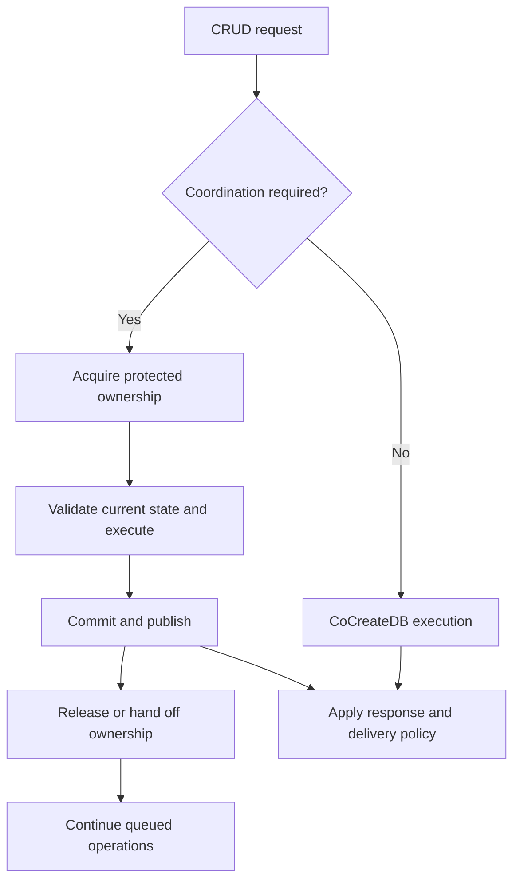

# Transactions vs. Synchronization

**Synchronization first. Transactional by requirement. Granular by design.**

CoCreateDB is designed around independent, indexed execution. Synchronization and transactional coordination can be composed around that execution rather than imposed on every operation.

Transactions are essential when correctness depends on exclusive access, atomic decisions or shared invariants. But the need for a transaction often exists only for a particular resource, during a particular operation, for a short period of time.

Why should every other operation pay for that guarantee?

## 1. The cost of mandatory coordination

Consider an execution model that requires transactional coordination for every mutation, even when no competing writer exists. Acquiring rights, validating state, maintaining transaction metadata and completing a commit can consume CPU, memory and time. When coordination crosses process or network boundaries, it can also introduce communication, waiting and additional infrastructure dependencies.

The cost is incurred whenever the protocol requires the work, not just when contention actually occurs.

A synchronization-first architecture permits independent mutations when their semantics allow it. It propagates changes and reconciles conflicts according to defined policies. Stronger coordination is introduced only when necessary to enforce a constraint.

| Independent execution | Mandatory coordinated execution |
| --- | --- |
| Apply ordinary mutations without distributed exclusive ownership | Establish the required transaction boundary before committing |
| Synchronize according to delivery policy | Coordinate and synchronize according to transaction and delivery policy |
| Resolve compatible conflicts through reconciliation | Validate or serialize conflicting operations under the selected protocol |
| Coordinate only protected resources | Incur the prescribed coordination cost even without contention |

This comparison targets architectures with mandatory coordination, not every transactional database. Optimistic concurrency, MVCC, local transactions and batching can substantially reduce overhead. Synchronization also has costs. The architectural opportunity is to avoid work that is unnecessary for the requested guarantee.

### Illustrative workload economics

Assume 10,000 mutations per second, of which 5% require exclusive ownership. If each protected mutation requires one logical acquisition and one release:

| Metric | Mandatory coordination | Selective coordination |
| --- | ---: | ---: |
| Mutations per second | 10,000 | 10,000 |
| Protected mutations per second | 10,000 | 500 |
| Lock operations per second | 20,000 | 1,000 |
| Lock operations per day | 1,728,000,000 | 86,400,000 |

Selective coordination avoids 95% of the modeled lock operations: 1.6416 billion per day. If a particular distributed protocol requires three messages per remote participant (request, grant and release), four remote participants would imply 120,000 versus 6,000 coordination messages per second before retries and ordinary replication.

These are illustrative operation counts, not measured performance or universal transaction costs. The 5% is a hypothetical workload assumption, not an industry statistic. Avoiding 95% of lock operations does not imply a 95% reduction in total resource use. Actual savings depend on the protocol, workload and equivalent guarantees.

**Scale coordination with the operations that need it, not with every operation the database performs.**

## 2. Synchronization does not require transactions

Ordinary data changes do not always require exclusive ownership. Independent assignments to different keys can be merged. Competing unconditional assignments can converge under deterministic ordering. Increments can commute when the counter semantics and duplicate-delivery protection permit it.

A transaction provides correctness within a defined execution boundary. Once it completes, another operation can change the state immediately. Applications still need synchronization to observe subsequent changes.

A consistent snapshot is not a permanently current view. Synchronization and transactions solve complementary problems: convergence across copies and correctness within a protected boundary.

Reconciliation requires explicit ordering, identity, deletion and overlapping-path rules. It cannot replace authoritative decisions for every invariant.

## 3. Transactions when needed

A protected operation may acquire exclusive write ownership over a key, object, array or broader resource. Other conflicting writes are queued, retried or rejected until the protected operation finishes. Unrelated operations continue where their semantics permit.

The basic lifecycle is straightforward:

CoCreate CRUD evaluates the applicable policy and invokes a coordination workflow when required. The workflow acquires ownership, validates the required state, executes the mutation through CoCreateDB, completes the requested commit and releases or hands off ownership. Conflicting writes, including peer mutations, must respect that ownership. Reads may observe committed state, wait or use another explicitly defined isolation policy.

Response timing is also a policy: ordinary operations may acknowledge in-memory execution; protected operations acknowledge only after the required commit, visibility and durability conditions are met. Receiving a request or placing it in a queue is not a successful transaction.

A lock supplies mutual exclusion, not automatically full ACID semantics. Atomic multi-object publication, isolation, durability and recovery need appropriate primitives or protocols. Ownership must be enforceable across all writers, with safe failure recovery, fencing where necessary and no conflicting grants during network partitions.

## 4. Model the constraint, not the entire database

Consider an event with 10,000 tickets. Purchase attempts can be independently created and synchronized as objects. An indexed ordering can derive provisional allocations without coordinating every attempt through a shared counter.

Final ticket confirmation is different: if overselling or displacing a confirmed purchaser is unacceptable, the final allocation needs an enforceable capacity constraint. A workflow can coordinate that specific decision through an authoritative allocator, atomic reservation or preallocated ticket rights. A quiet period or local count cannot establish global exclusivity.

Likewise, a strict unique key requires an atomic claim across eligible writers, while unrelated keys can remain independently writable. A financial transfer may require an atomic commit spanning multiple objects. A transaction can itself be represented as data, but recording the intent does not make its effects atomic.

The constraint determines the coordination boundary. It need not determine the execution model of every object in the database.

## 5. Composable execution

CoCreateDB owns living artifacts, scopes, indexes and local CRUD execution. It does not own distributed locks, peer inventories, persistence providers or transactional workflows.

CoCreate CRUD and Workflow/AST compose the required behavior before, around and after execution:

- **Before:** acquire missing state, authorize, evaluate policies and acquire protected rights where required.
- **During:** execute independent or protected operations using the same engine primitives; stage or atomically publish changes where the required guarantees support it.
- **After:** complete the requested durability, synchronize changes, release ownership and respond according to policy.

Communication layers deliver messages and maintain awareness; persistence workflows manage durable state. Neither ordinary synchronization nor optional persistence alone establishes a transactional guarantee. A response-stabilization workflow may wait for observed changes to settle, but silence is not proof of convergence or isolation.

This is an architectural direction, not a claim that distributed transactions, atomic batches or complete reconciliation are already implemented. See [CRUD](specifications/crud.md), [reconciliation](specifications/reconciliation.md), [distribution](specifications/distribution.md) and [persistence](specifications/persistence.md).

## 6. The architectural advantage

An architecture that permits independent execution can add coordinated execution when needed. An architecture that makes coordination mandatory cannot bypass that requirement without changing its execution contract.

This is the fundamental asymmetry. It does not mean every transactional database is slower, or that a synchronization-first engine automatically provides equivalent ACID guarantees. It means mandatory coordination limits the available execution paths, while composable coordination preserves the choice.

CoCreateDB aims to make transactions a capability of the system rather than a prerequisite of the database. Performance should be evaluated with equivalent workloads and guarantees, including independent writes, contention, protected operations and failure recovery.

**Execute independently when possible. Synchronize by policy. Coordinate by necessity.**

**Transaction-capable, not transaction-dependent.**
